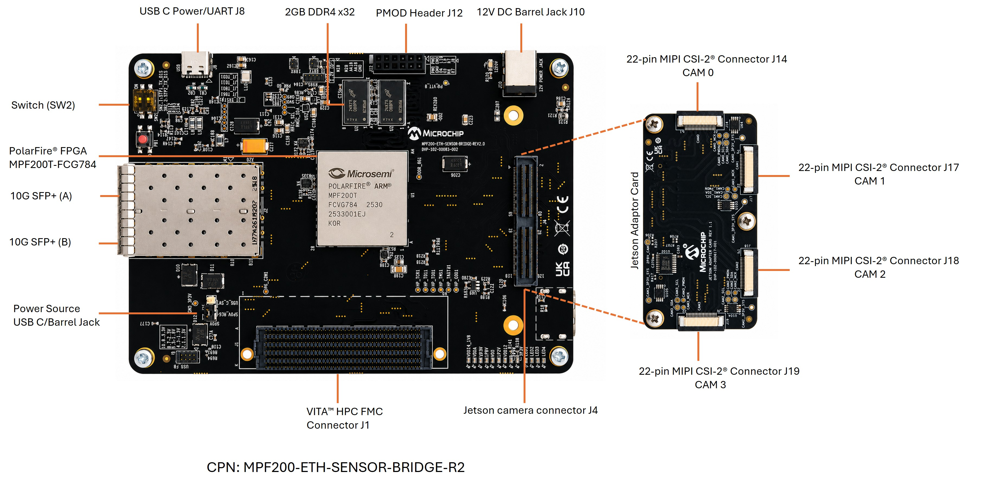
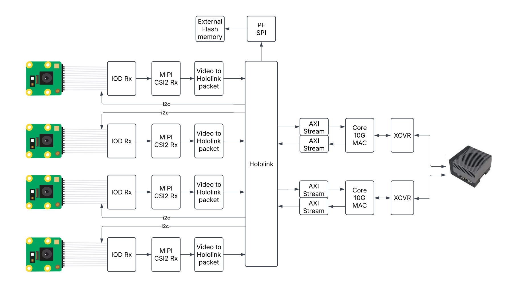
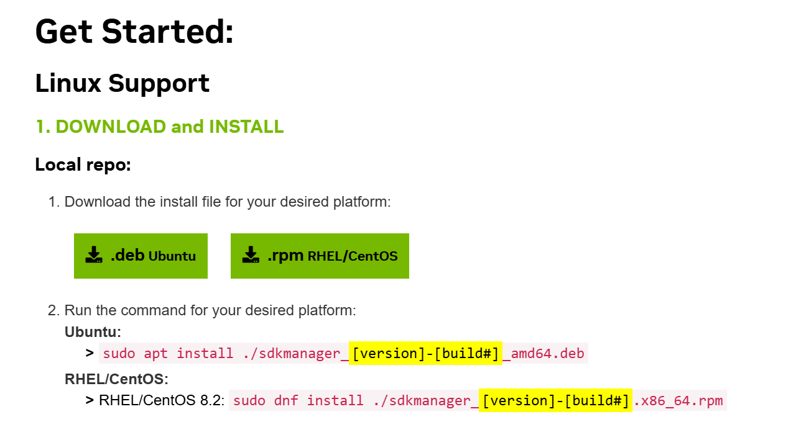
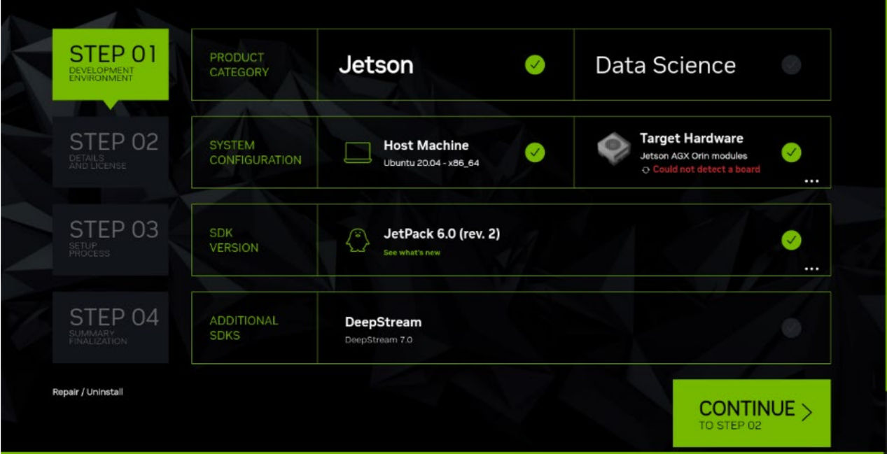
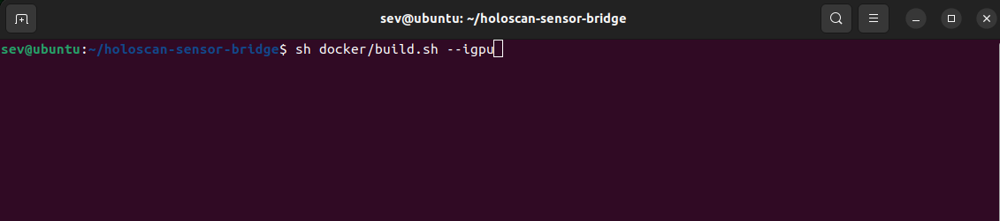
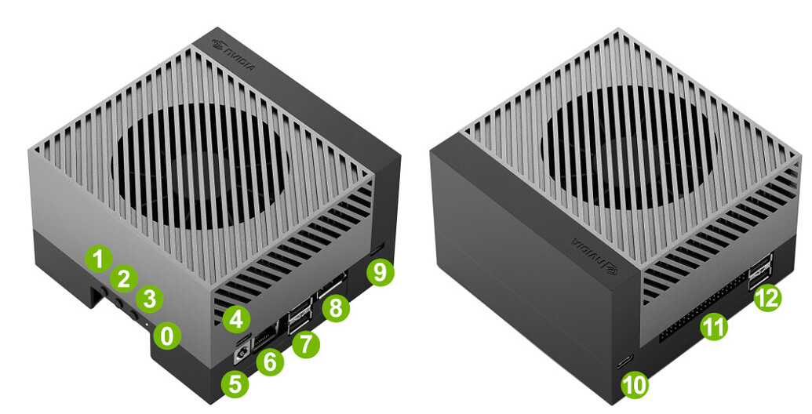
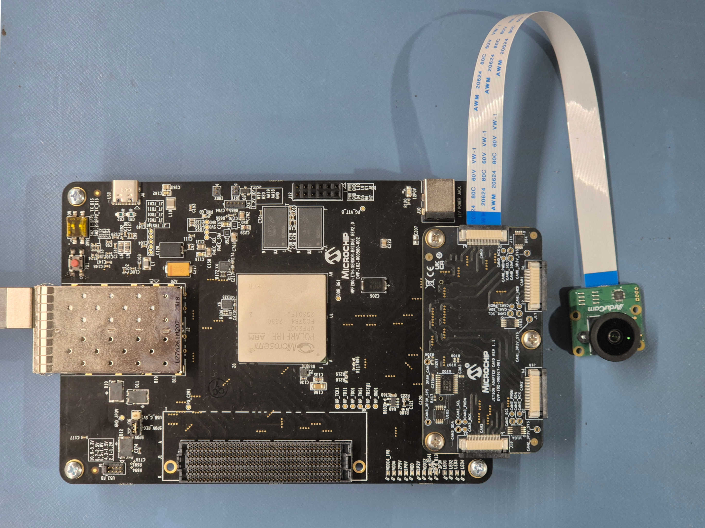
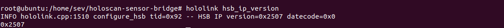

# PolarFire Ethernet Sensor Bridge for NVIDIA AGX and IGX AI Applications
## Introduction

This application note explains how to interface the PolarFire® Ethernet Sensor
Bridge (PFESB) board with an NVIDIA Holoscan Sensor Bridge compatible device.

The Holoscan Sensor Bridge software on the Holoscan Sensor Bridge compatible
device supports various applications such as AI applications, stereo vision, and
so on. The software can also be used for configuring the cameras connected to the
FPGA board and updating the FPGA design.

Topics covered by this demo include:

- Streaming the Video
- Running Pose Estimation on AGX Developer Kit
- Running Multiple Cameras with One Ethernet Port
- Running Two Cameras using Two Ethernet Ports
- Latency Measurement

The following figure highlights various components of the PFESB.

**Figure 1. Callout Image**



## Table of Contents

1. [Demo Requirements](#1-demo-requirements)
2. [Licensing](#2-licensing)
3. [Functional Description](#3-functional-description)
4. [Setting up the Jetson AGX Orin Developer Kit](#4-setting-up-the-jetson-agx-orin-developer-kit)
   - 4.1. [NVIDIA Holoscan Sensor Bridge Setup](#41-nvidia-holoscan-sensor-bridge-setup)
   - 4.2. [IGX Thor/Orin Setup](#42-igx-thororin-setup)
   - 4.3. [Debug and Troubleshooting](#43-debug-and-troubleshooting)
5. [Setting up the MPF200-ETH-SENSOR-BRIDGE Kit](#5-setting-up-the-mpf200-eth-sensor-bridge-kit)
6. [Board Setup](#6-board-setup)
7. [Check Current PFESB Program Version](#7-check-current-pfesb-program-version)
8. [Update HSB Firmware](#8-update-hsb-firmware)
9. [Running the Demo](#9-running-the-demo)
    - 9.1. [Streaming the Video](#91-streaming-the-video)
    - 9.2. [Running Pose Estimation](#92-running-pose-estimation)
    - 9.3. [Running Multiple Cameras with One Ethernet](#93-running-multiple-cameras-with-one-ethernet)
    - 9.4. [Running Two Cameras Using Two Ethernet Ports](#94-running-two-cameras-using-two-ethernet-ports)
    - 9.5. [Latency Measurement](#95-latency-measurement)
- [Appendix A: Design Creation Using TCL Scripts](#appendix-a-design-creation-using-tcl-scripts)
- [Appendix B: Programming the Device Using FlashPro Express](#appendix-b-programming-the-device-using-flashpro-express)
- [Appendix C: Debug and Troubleshooting](#appendix-c-debug-and-troubleshooting)

## 1. Demo Requirements

The following table lists the hardware and software required for running the demo.

**Table 1-1. Demo Requirements**

| Requirement | Description |
| --- | --- |
| Hardware and Accessories: **MPF200-ETH-SENSOR-BRIDGE** | Kit Contents: <br>• MPF200-ETH-SENSOR-BRIDGE — 1 <br>• IMX477 camera module — 1 (12.3 MP 477M HQ Camera Module for Raspberry Pi with 135° (D) M12 Wide Angle Lens, SKU: B0466R; to buy Arducam, see [`www.arducam.com/shop-arducam/`](https://www.arducam.com/shop-arducam/)) <br>• Jetson Adapter Card Rev 1.1 <br>• SFP+ adapter — 1 (Part Number: SFP-10G-T-S from Wiitek) <br>• 12V AC adapter — 1 <br>• MIPI 22 to 22 pin cable — 1 <br>• USB Type-C cable — 1 <br>• Cat7 Ethernet cable — 1 |
| NVIDIA AGX Developer Kit | NVIDIA Jetson AGX Orin Developer Kit (64 GB). Kit Contents: <br>• Jetson AGX Orin module with heat sink and reference carrier board <br>• USB-C power adapter and cord <br><br>If using IGX devices, see [`docs.nvidia.com/igx/user-guide/latest/OV/introduction.html`](https://docs.nvidia.com/igx/user-guide/latest/OV/introduction.html) for setup and configuration. |
| NVIDIA Holoscan Sensor Bridge Software Package | Download the Release 2.6.0  from [here](https://github.com/nvidia-holoscan/holoscan-sensor-bridge)|
| USB mouse and keyboard | 1 |
| Display port monitor | 1 |
| Ubuntu PC | OS version 22.04 or higher |

## 2. Licensing

The following are the licensing options:

- **Free:** Use the preprogrammed job file without making any changes to the design.
- **Libero® SoC Design Suite Gold License:** Make changes to the design files.
- **Core10GMAC License:** Build a design using the encrypted and licensed Core10GMAC.

> **Note:** You need a license to build the Core10GMAC IP.

## 3. Functional Description

The demo highlights the capability of the PolarFire® Ethernet Sensor Bridge board
to stream 4K 60 fps video from MIPI CSI2 sensor inputs to the NVIDIA Holoscan
Sensor Bridge compatible device, through a 10G connection. The PolarFire FPGA's
High-speed IOD inputs and the MIPI CSI2 DPHY Rx decoder IP convert the MIPI CSI2
DPHY Rx serial data into video pixel data. These video pixels are then converted
into a 64-bit AXI stream format, as defined by the Holoscan Sensor Bridge IP, and
subsequently transformed into ethernet packets. A Core10GMAC IP and high-speed
transceivers enable the streaming of these ethernet packets through a 10G SFP+
connection, which the NVIDIA Holoscan Sensor Bridge compatible device receives to
execute AI applications.

The PolarFire (PF) system services manage the FPGA reprogramming through the SPI
Flash interface, interfacing with the Holoscan Sensor Bridge through the APB
interface. Camera settings are configured through the I2C interface of the
Holoscan Sensor Bridge IP.

The following figure shows the functional block diagram of the PolarFire Ethernet
Sensor Bridge board.

**Figure 3-1. Functional Block Diagram**



## 4. Setting up the Jetson AGX Orin Developer Kit

This section explains how to set up and upgrade the Holoscan ecosystem. This
ecosystem includes the NVIDIA Holoscan SDK, Jetson AGX Orin Developer Kit,
Microchip Holoscan Sensor Bridge Board and MIPI Edge-AI Reference Design.

To set up the Holoscan ecosystem, perform the following steps:

1. Create an [**NVIDIA Account**](https://developer.nvidia.com/developer-program) and join the **Developer Program**.
2. Download the SDK Manager. On a computer running Ubuntu 22.04 or later, download
   the [**SDK Manager**](https://developer.nvidia.com/sdk-manager).
   - Navigate to the "Get Started" section.
   - Follow the steps in the "Download and Install" and "Launch" subsections.

   The following figure shows the process of downloading and installing the SDK.

   **Figure 4-1. Downloading and Installing the SDK**

   


3. After launching the SDK Manager:
   - Follow the steps in the "Install Jetson Software with SDK Manager" section of
     the [**NVIDIA SDK Manager User Manual**](https://docs.nvidia.com/sdk-manager/install-with-sdkm-jetson/index.html) (Step 1 through Step 4).
   - Flashing the Jetson AGX Orin Developer Kit takes about 50 minutes.

   **Figure 4-2. Flashing the Jetson AGX Orin Developer Kit**

   


4. After flashing is done, connect a monitor, keyboard and mouse to the Jetson AGX
   Orin Developer Kit.
5. Power on the device and log in using the username and password credentials set
   up during Step 3 of the [**NVIDIA SDK Manager User Manual**](https://docs.nvidia.com/sdk-manager/install-with-sdkm-jetson/index.html).

### 4.1. NVIDIA Holoscan Sensor Bridge Setup

To set up the NVIDIA Holoscan Sensor Bridge, perform the following steps:

1. Follow the steps in the "Host Setup" subsection of the [**NVIDIA Holoscan Sensor
   Bridge User Manual**](https://docs.nvidia.com/holoscan/index.html#nvidiatab-sensor-bridge) to download and configure the Docker container, as shown in
   the following figure.

   **Figure 4-3. Building the Demo Container**

   


2. After setup, run the software loopback tests. When the tests pass successfully,
   the setup is complete. To run the example applications, follow the steps in the
   "Running Holoscan Sensor Bridge Examples" section of the [**NVIDIA Holoscan
   Sensor Bridge User Manual**](https://docs.nvidia.com/holoscan/sensor-bridge/latest/examples.html).

   **Figure 4-4. Running Software Loopback Tests**

   


### 4.2. IGX Thor/Orin Setup

To set up the NVIDIA IGX Thor or Orin devices, see the instructions found at
[**NVIDIA IGX Platform Overview**](https://docs.nvidia.com/igx/user-guide/latest/OV/introduction.html).

### 4.3. Debug and Troubleshooting

This section addresses common issues you might face when setting up the Holoscan
Development Ecosystem.

**Downloading the SDK**

If you are unable to install or launch the Holoscan SDK during "Step 2" of the
[_Setting up the Jetson AGX Orin Developer Kit_](##-4.-setting-up-the-jetson-agx-orin-developer-kit) section, ensure that you download
the Debian file (`.deb`), as the PC's operating system should be Ubuntu. The Debian
file can be found under the "Get Started" and "Download and Install" sections on
the [**SDK Manager**](https://developer.nvidia.com/sdk-manager) webpage. Important points to consider when working with the
downloaded file:

- The downloaded file should be similar to: `sdkmanager_2.1.0-11682_amd64.deb`.
  In this case the version number corresponds to `2.1.0` and the build number
  corresponds to `11682`.
- When running the `sudo apt install` command, point to the downloaded Debian file
  with the appropriate version and build numbers specified. For example:

  ```bash
  sudo apt install ./sdkmanager_2.1.0-11682_amd64.deb
  ```

**Detecting the Developer Kit**

When preparing to flash the Jetson AGX Orin Developer Kit during "Step 3" of the
_Setting up the Jetson AGX Orin Developer Kit_ section, follow the steps outlined
in the [**NVIDIA SDK Manager User Manual**](https://docs.nvidia.com/sdk-manager/install-with-sdkm-jetson/index.html). To ensure proper detection of the
Developer Kit, make sure that the Ubuntu PC and the Jetson AGX Orin Developer Kit
are connected as specified:

- Ubuntu PC (USB-A or USB-C port) to AGX USB-C Port 10.
- Connect Power to AGX USB-C Port 4.

**Figure 4-5. Jetson AGX Orin Developer Kit Ports**




- When connecting the Developer Kit during "Step 1" of the [**NVIDIA SDK Manager
  User Manual**](https://docs.nvidia.com/sdk-manager/install-with-sdkm-jetson/index.html), ensure that "Jetson AGX Orin [64GB Developer Kit Version]" is
  selected.
- In "Step 3" of the [**NVIDIA SDK Manager User Manual**](https://docs.nvidia.com/sdk-manager/install-with-sdkm-jetson/index.html), you will be prompted to
  connect the Jetson AGX Orin Developer Kit.
  - If the Developer Kit is already connected to the Ubuntu PC, disconnect the
    USB-C cable from Port 10 on the AGX, then reconnect it.
  - Follow the instructions to set the AGX into recovery mode by pressing Button 1
    and Button 2.
  - The flashing process can take approximately 30 minutes. You can monitor the
    installation progress during this time.

## 5. Setting up the MPF200-ETH-SENSOR-BRIDGE Kit

The MPF200-ETH-SENSOR-BRIDGE comes as a kit, with the following items in the box:

- MPF200-ETH-SENSOR-BRIDGE
- 12V power adapter
- SFP+ to RJ45 converter
- Ethernet cable
- IMX477 camera along with lens and cable
- Jetson Adapter Card
- Acrylic camera stand

Ensure that the jumpers are set correctly, as listed in the following table.

**Table 5-1. Jumper Settings**

| Jumper | Default Position |
| --- | --- |
| J9 | Close pins 9 and 10 (3.3V) |
| J36 | Close pins 1 and 2 (DC Power); Close pins 2 and 3 (USB-C Power) |

## 6. Board Setup

To set up camera 0, perform the following steps:

1. Make sure that the MPF200-ETH-SENSOR-BRIDGE board is powered off.
2. Connect the camera to the IMX477 camera module through the **J14** MIPI
   connector found on the Jetson Adapter Card Rev 1.1, then connect the Jetson
   Adapter Card to the MPF200-ETH-SENSOR-BRIDGE through the **J4** connector, using
   the 22 pin to 22 pin camera cable, as shown in the following figure.

   **Figure 6-1. Setup of Camera 0**

   


3. Insert SFP+ to RJ45 converter into the SFP cage on **J6**.
4. Connect the ethernet cable from the SFP+ RJ45 port to the ethernet port on the
   NVIDIA Holoscan Sensor Bridge compatible device.
5. Connect the 12V power adapter to the **J10** power input port.

> **Note:** Connect USB-C to **J8** and ensure the J36 jumper is closed on the
> USB_C_5V configuration.

## 7. Check Current PFESB Program Version

To find the PFESB program version, execute the following commands:

```bash
xhost +
sh docker/demo.sh
hololink-enumerate
```

The following figure shows how to find the PFESB program version.

**Figure 7-1. Check PFESB Program Version**



## 8. Update HSB Firmware

To update to the latest version, run the following steps (one-time requirement):

1. First, check the current version using the instructions provided in the
   preceding section. To flash a new SPI file, run the following inside the demo
   container:

   ```bash
   $ hsb_flasher -H <ESB IP ADDRESS> -t <SPI FLASH VERSION>
   # For example:
   $ hsb_flasher -H 192.168.0.2 -t 2603
   ```

2. If a SPI file is located on the NVIDIA device, the following command can be used
   to flash it:

   ```bash
   $ hsb_flasher -H <ESB IP ADDRESS> --bit-file <SPI FLASH FILE>
   # For example:
   $ hsb_flasher -H 192.168.0.2 --bit-file PF_ESB_HSB2603_v2025p2.spi
   ```

The first command will take up to 20 minutes to complete, and the status will be
displayed during the process.

## 9. Running the Demo

This section explains how to run the demo using different features.

### 9.1. Streaming the Video

To run the high-speed video player with IMX477, using camera 0 setup, perform the
following steps:

1. In a new terminal, change the directory to the `holoscan-sensor-bridge` folder:

   ```bash
   cd <PATH/TO/holoscan-sensor-bridge>
   ```

2. Run the following commands to run the docker image (this runs the
   `holoscan-sensor-bridge` docker container):

   ```bash
   xhost +
   sh docker/demo.sh
   ```

3. Run the high-speed video player Holoviz with live video by executing the
   following command for camera 0 setup:

   ```bash
   python examples/linux_imx477_player.py
   ```

4. Close the Holoviz application.
5. To close the Holoscan docker, enter `Exit` in the terminal.

### 9.2. Running Pose Estimation

The pose estimation example can be run using camera 0 setup. Perform the following
steps:

1. In a new terminal, change the directory to the `holoscan-sensor-bridge` folder:

   ```bash
   cd <PATH/TO/holoscan-sensor-bridge>
   ```

2. Run the following commands to run the docker image (this runs the
   `holoscan-sensor-bridge` docker container):

   ```bash
   xhost +
   sh docker/demo.sh
   ```

3. Follow the _Running the body pose example_ section described at
   [`docs.nvidia.com/holoscan/sensor-bridge/latest`](https://docs.nvidia.com/holoscan/sensor-bridge/latest/).
4. Run the pose estimation by executing the following command for camera 0 setup:

   ```bash
   python example/linux_body_pose_estimation_imx477.py
   ```

5. Close the Holoviz application.
6. To close the Holoscan docker, enter `Exit` in the terminal.

### 9.3. Running Multiple Cameras with One Ethernet

The PFESB kit comes with one IMX477 camera module. Update jumpers to Rev2 board
configuration. To stream two IMX477 cameras using a single ethernet connection to
the AGX port, connect one end of the ethernet cable to the **J5** SFP port of the
PFESB, and the other end to the AGX ethernet port. Then, execute the following
commands:

```bash
$ xhost +
$ sh docker/demo.sh
$ python3 examples/linux_single_network_multi_imx477_player.py
```

The PFESB kit supports up to 4 cameras with the Jetson Adapter Card. To stream up 
to 4 cameras run the following:

```bash
$ xhost +
$ sh docker/demo.sh
$ python3 examples/linux_single_network_multi_imx477_player.py  --num-cameras 4
```

### 9.4. Running Two Cameras Using Two Ethernet Ports

To stream two IMX477 cameras through two Ethernet ports connected to RDMA-capable
ports, first run the container and then execute the following commands:

```bash
$ xhost +
$ sh docker/demo.sh
$ python3 examples/stereo_imx477_player.py
```

> **Note:** The AGX has a single 10G Ethernet connection. To run this demo on AGX,
> you require a Network Interface Card (NIC), such as ConnectX®-6 Dx, or use both
> 10G Ethernet connections for the IGX Thor/Orin.

### 9.5. Latency Measurement

The latency measurement gives best results when used either with an IGX device or
an AGX with a ConnectX NIC.

To get a complete latency report of the pipeline using RDMA, execute the following
commands:

```bash
$ xhost +
$ sh docker/demo.sh
$ python3 examples/imx477_latency.py
```

After the Holoviz window opens, let it run for a few seconds and then close it. The
complete latency report will be displayed on the terminal.

## Appendix A: Design Creation Using TCL Scripts

Download the contents of this repository . TCL scripts are placed under `hw` directory.

To run the TCL, perform the following steps:

1. Launch the Libero SoC software.
   
2. Click **Project** > **Execute Script.....**
   
3. Click **Browse** and select `script.tcl` from the downloaded `hw` directory. 

4. Click **Run.**
   
After successful execution of TCL script, Libero project is created within `hw` directory. Job file is created in the folder hw/PF_ESB/designer/PF_ESB_top/export. For more information about TCL scripts, see `hw/README.md`.<br>

For more details on TCL commands, see [Libero SoC TCL Command Reference Guide](https://coredocs.s3.amazonaws.com/Libero/2021_3/Tool/libero_soc_tcl_cmd_ref_ug.pdf). Contact [Technical Support](https://www.microchip.com/en-us/support) for any queries encountered when running the TCL script.

<a name="appendix-b-programming-the-device-using-flashpro-express"></a>
## Appendix B: Programming the Device Using FlashPro Express

Pre-built programming job file is available in this repo release [assests](https://github.com/microchip-fpga-solutions/mpf200-esb-mipi/releases).

This section describes how to program the PolarFire device with the job programming file using Flashpro Express. Connect the USB Type-C cable from the Host PC to **J8** of the MPF200-ETH-SENSOR-BRIDGE kit and launch the FlashPro Express tool from the installation directory. For detailed information about how to program the device using FlashPro Express, see [FlashPro Express User Guide](https://ww1.microchip.com/downloads/aemDocuments/documents/FPGA/swdocs/libero/flashpro_express_ug_2025_1.pdf). 

<a name="appendix-c-debug-and-troubleshooting"></a>
## Appendix C: Debug and Troubleshooting

### Docker Runtime & Board Connectivity

**Table C-1. Docker Runtime & Board Connectivity Issues**

| Issue | Solution |
| --- | --- |
| IP not found or cannot connect to board IP when running the example inside the Docker container | Verify that the board is reachable by running `ping` from the Docker container. If ping works but the application still cannot connect, check that the NVIDIA host machine (AGX/IGX, etc.) is assigned an IP address in the **192.168.0.X** subnet as specified in the application note. If the IP is not assigned, configure the correct IP address on the NVIDIA host and verify that the board can be pinged successfully before rerunning the example. |

### Camera & Holoviz Issues

**Table C-2. Camera & Holoviz Issues**

| Issue | Solution |
| --- | --- |
| Blank screen in Holoviz when running the example inside the Docker container | Verify that the camera is connected to the correct MIPI CSI connector. Check that the MIPI cable is properly seated and is not damaged. Reconnect or replace the cable if necessary. |

### SDK & Software Compatibility

**Table C-3. SDK & Software Compatibility Issues**

| Issue | Solution |
| --- | --- |
| Incompatible SDK or Holoscan IP version error when running the example inside the Docker container | Update the SDK or the JOB file to a compatible version. **Note:** Hardware Revision 2 is supported starting from **SDK v2.6.0**, and requires **JOB file version 26.03** or later. |

## Microchip FPGA Support

Contact the Technical Support Center through the website at
[`www.microchip.com/support`](https://www.microchip.com/support). Mention the FPGA Device Part number, select the
appropriate case category, and upload design files while creating a technical
support case.

Contact Customer Service for non-technical product support, such as product
pricing, product upgrades, update information, order status, and authorization.

- From North America, call **800.262.1060**
- From the rest of the world, call **650.318.4460**
- Fax, from anywhere in the world, **650.318.8044**

---

*Trademarks and legal notices: the "Microchip" name and logo and related brands are
registered/unregistered trademarks of Microchip Technology Incorporated or its
affiliates. See [`https://www.microchip.com/en-us/about/legal-information/microchip-trademarks`](https://www.microchip.com/en-us/about/legal-information/microchip-trademarks).
This information is provided by Microchip "AS IS" without warranties of any kind.*
